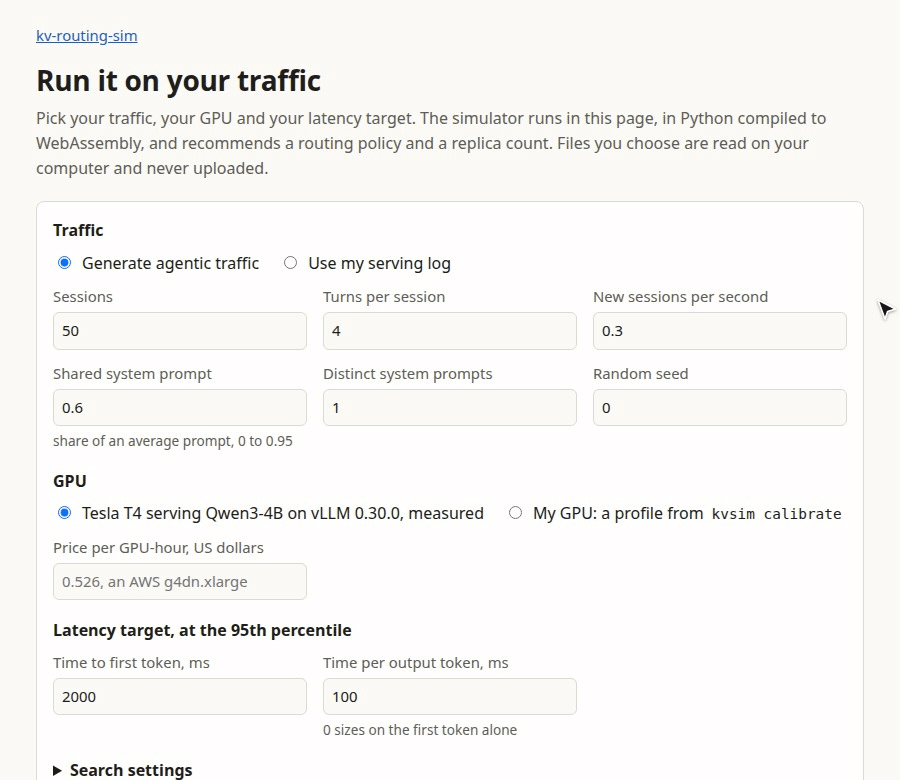
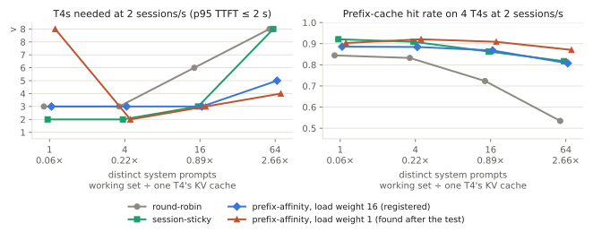

# kv-routing-sim

**A calibrated instrument, plus a replication.** This is a trace-driven simulator of LLM serving
across replicas. Its prefix-cache model was checked against a live vLLM's own counters, and **the
error is published**. Its routing result agrees with what others had published first: it is a
replication, not a new result. Every test was written down before it ran, and the ones that failed
are in the table below.

**[Run it on your traffic](https://gitgod-debug.github.io/kv-routing-sim/run.html)**, in the browser: nothing to install, and a log you choose is never uploaded.

## The instrument: what was checked, and how far off it is

| | |
|---|---|
| **Checked against** | a live **vLLM 0.30.0** (`--enable-prefix-caching`) serving `Qwen/Qwen3-4B` on **2× Tesla T4** — its own `vllm:prefix_cache_hits` ÷ `vllm:prefix_cache_queries`, and each request's cached tokens |
| **The cache model** | **exact** on two workloads under eviction pressure: every counter and every request, three runs each · hit rates within **1.4%** on two live replicas under three routing policies |
| **The timing model** | p95 TTFT within **1.4×** on traffic it never saw · p95 time per output token within **7%** around a 100 ms limit · ⛔ 1.5–1.7× off when a GPU is at the knee of its load curve |
| **The routing result** | On a T4, among the standard policies: keep each session on one GPU. ⚠️ **Not a new result** — SMetric (2026) reached it on production traces and LMetric (OSDI '26) had shown why; this is an independent agreement ([the finding](#the-finding)). A simulator's GPU count is good to **± one**: measured, across three calibrations of one GPU |

## Validity: where these numbers hold

| | What was used | So do not read a number here as |
|---|---|---|
| **Engine and version** | vLLM **0.30.0**. The current release is 0.34.0 (16 November 2026); its cache code has changed, and it has not been checked | true of "vLLM" in general |
| **GPU** | one Tesla T4 for the exact checks, two for the two-replica check; three calibrations of that one GPU type | another GPU's latency, GPU count or rupees |
| **Model** | `Qwen/Qwen3-4B` | another model's: its timing and its cache size have to be measured again (`kvsim calibrate`) |
| **Replicas** | live: 1 and 2. Simulated: 1 to 16, and to 32 under the two-part target | a measured fleet: beyond two replicas every count is the simulator's |
| **Block size and cache** | blocks of 16 tokens; 1,537 blocks on a T4, and 512 in the exactness test | valid for another block size or cache size without a new run |
| **Traffic** | generated agent sessions of 4 turns and about 1,700 prompt tokens; three public traces, scaled down 16 to 64 times to fit a T4 | production traffic at its real size, or sessions of unequal length |

## What one agent session costs, by routing policy

One shared system prompt, 2 sessions a second, each policy at the fewest T4s that meet the target.
A session sends 6,800 prompt tokens in 4 requests. 519 of them are new: no routing can avoid
computing them. *Re-prefilled* tokens are what the GPUs computed beyond that, which a cache shared
by all GPUs would have saved.

| Target | Policy | T4s | Cache hit rate | Re-prefilled tokens per session (95% interval) | ₹ per session |
|---|---|---:|---:|---:|---:|
| p95 time to first token ≤ 2 s | session-sticky | 5 | 92.0% | 27 (7 to 54) | 0.047 |
| | round-robin | 7 | 82.5% | 669 (627 to 718) | 0.063 |
| | balanced prefix-affinity | 10 | 85.9% | 438 (398 to 483) | 0.091 |
| | least-loaded | 11 | 81.0% | 777 (736 to 824) | 0.098 |
| and p95 time per output token ≤ 100 ms | session-sticky | 10 | 91.5% | 61 (27 to 102) | 0.091 |
| | least-loaded | 13 | 80.5% | 805 (760 to 857) | 0.118 |
| | round-robin | 14 | 80.1% | 834 (785 to 889) | 0.126 |

Simulated, on calibration A of one T4 (vLLM 0.30.0, Qwen3-4B), with generated traffic; the
intervals are bootstrap intervals over sessions. A policy without a row met the target at no GPU
count of the grid. Session-sticky's 27 tokens are the shared prompt, computed once on each further
GPU. Rupees are counted over a short trace's whole run: a service that ran all day at this rate
would pay about a quarter less. Registered before it ran, as S1:
[the report](artifacts/results/session_cost/report.md), made by `scripts/session_cost.py`.

## Every registered test, and what happened

Each prediction was committed before its test ran; [the log](docs/09-hypotheses.md) has the dated
entries. Of 19 rows, 9 held (H4 only in an amended form), 4 failed, and 6 held in part or are not
settled.

| Test | Predicted | Outcome |
|---|---|---|
| **H1** | prefix-affinity routing has a higher cache hit rate than least-loaded at every replica count | ⛔ failed: true at 1–2 sessions/s, gone or reversed from 3/s |
| **H2** | there is a sharing ratio beyond which prefix routing wins | ⛔ failed: pure prefix-affinity loses at every sharing above 0 |
| **H2b** | prefix routing pays once tenants' prompts outgrow one GPU's cache | ✅⛔ not settled: held on the first timing model, failed on calibration A of the checked one, held on B and C |
| **H3** | calibration error in single digits (%) on two workload shapes | ✅ held: zero error on two shapes, +0.3% on a third |
| **H4** | the residual of a naive cache model is eviction-order skew | ✅ held, in an amended form: it is capacity skew (−11.9 points) |
| **H5** | the cost win is one fewer replica at a fixed target | ✅⛔ in part: only for balanced prefix-affinity at low sharing |
| **H6** | the ranking of policies does not depend on the hardware | ✅⛔ in part: the ranking moves (τ-b down to 0.51), the direction of the flip does not; first timing model only |
| **R1** | on the Mooncake trace, prefix-affinity beats session-sticky on tool-agent traffic and never on conversation | ⛔ failed: both directions wrong |
| **R2** | on the AgentX trace, session-sticky and balanced prefix-affinity tie | ✅ held, on the first timing model |
| **R1, R2 again** | the same two on the checked timing model: R1 fails again, R2 holds | ✅⛔ in part: R1 failed again, as predicted; R2 could not be tested as designed |
| **R3** | four rules for the two published policies, ported, on a public production trace | ✅⛔ in part: 2 of 4 held |
| **Phase 6** | hit rates on two live replicas within 10% | ✅ held: within 1.4%, run twice. Latency came out 5–222× off, which led to C2 |
| **C1** | `kvsim calibrate` works on a real GPU, and its cache check is exact | ✅ held: 48 of 48 requests |
| **C2** | three timing predictions, one of them that a busy second GPU does not slow the first | ✅ held: all three (1.92×, 1.00×, within 1.41×) |
| **C3** | a profile fitted on a real GPU predicts traffic it never saw within 2× | ✅ held: all three (exact, 1.41×, 1.38×) |
| **C4** | nine rules for per-token timing on a real T4 | ✅⛔ in part: 7 of 9 held |
| **T1** | per-token latency within 1.5× on five held-out runs | ⛔ failed: 1.54× and 1.71× at the knee of the load curve, within 1.07× off it |
| **T2** | with a limit on token speed too, session-sticky is still best or tied | ✅ held, on three calibrations; the GPU counts about double |
| **S1** | three predictions for the session cost table above, which is derived from cells already read | ✅ held at the registered cell; one of its rules fails in 4 of 86 cells outside it |

## If you have five minutes

1. [Every registered test, and what happened](#every-registered-test-and-what-happened): 19 rows; 4 failed and 6 held only in part.
2. [The calibration report](artifacts/results/phase3_kaggle_t4/calibration_report.md): predicted against measured, request by request, and the residual explained.
3. [The finding, as a replication](#the-finding), next to the work that came first ([`docs/04-prior-art.md`](docs/04-prior-art.md)).
4. [What one agent session costs](artifacts/results/session_cost/report.md) under each routing policy.
5. [What breaks at 10× and 100×](artifacts/results/scale/report.md), measured.
6. [Why it is built this way](docs/02-architecture-decisions.md): thirteen decision records.

<details>
<summary><b>Evidence ledger</b> — for each number above: the file that holds it, what made that file, and the commit</summary>

<!-- ledger:start -->
| Claim | Number | Results file | Made by | Commit |
|---|---|---|---|---|
| Cache model exact on two workloads, three runs each | 3 of 3 runs, on both | [`phase3.json`](artifacts/results/phase3_kaggle_t4/phase3.json) | `notebooks/phase3_calibration.ipynb` | `8efaa7a` |
| A third, concurrent workload (H3) | +0.3% | [`fitted_profile.json`](artifacts/results/phase3_kaggle_t4/fitted_profile.json) | `scripts/phase3_analyze.py` | `8efaa7a` |
| What a naive cache model misses (H4) | −11.9 points | [`phase3.json`](artifacts/results/phase3_kaggle_t4/phase3.json) | `notebooks/phase3_calibration.ipynb` | `8efaa7a` |
| Hit rates on two live replicas (Phase 6) | within 1.4% | [`analysis.json`](artifacts/results/phase6_kaggle_t4/analysis.json) | `scripts/phase6_analyze.py` | `3a5cd89` |
| Latency on those two replicas, first timing model | 5–222× off | [`analysis.json`](artifacts/results/phase6_kaggle_t4/analysis.json) | `scripts/phase6_analyze.py` | `3a5cd89` |
| The calibration command's cache check (C1) | 48 of 48 requests | [`c1.json`](artifacts/results/c1_kaggle_t4/c1.json) | `notebooks/c1_calibrate_t4.ipynb` | `3a5cd89` |
| Timing: three predictions (C2) | 1.92×, 1.00×, within 1.41× | [`analysis.json`](artifacts/results/c2_kaggle_t4/analysis.json) | `scripts/c2_analyze.py` | `8899fd9` |
| p95 time to first token on traffic the fit never saw | within 1.4× | [`analysis.json`](artifacts/results/c2_kaggle_t4/analysis.json) | `scripts/c2_analyze.py` | `8899fd9` |
| p95 time per output token around the limit (C4) | within 7% | [`analysis.json`](artifacts/results/c4_kaggle_t4/analysis.json) | `scripts/c4_analyze.py` | `81012bb` |
| Nine rules for per-token timing (C4) | 7 of 9 held | [`analysis.json`](artifacts/results/c4_kaggle_t4/analysis.json) | `scripts/c4_analyze.py` | `81012bb` |
| Per-token latency at the knee of the load curve (T1) | 1.54× and 1.71× | [`t1.json`](artifacts/results/t1_itl/t1.json) | `scripts/t1_itl_check.py` | `904765c` |
| Per-token latency off the knee (T1) | within 1.07× | [`t1.json`](artifacts/results/t1_itl/t1.json) | `scripts/t1_itl_check.py` | `904765c` |
| GPU counts under the two-part target (T2) | 1.93–2.00× the first-token counts | [`analysis.json`](artifacts/results/t2_two_part_slo/analysis.json) | `scripts/t2_analyze.py` | `904765c` |
| A GPU count is good to ± one | 102 of 144 counts equal on three calibrations, 138 within one | [`posthoc_three_calibrations.json`](artifacts/results/c3_kaggle_t4/posthoc_three_calibrations.json) | `scripts/c3_posthoc_grid.py` | `b5f5d6c` |
| Ranking of policies across hardware (H6) | τ-b down to 0.51 | [`h6.json`](artifacts/results/h6_ranking/h6.json) | `scripts/run_h6.py` | `892b481` |
| Two published policies on a production trace (R3) | 2 of 4 held | [`analysis.json`](artifacts/results/r3_bailian/analysis.json) | `scripts/r3_analyze.py` | `c4109a0` |
| New tokens in a session | 519 of 6,800 | [`session_cost.json`](artifacts/results/session_cost/session_cost.json) | `scripts/session_cost.py` | `a27cbaf` |
| Session-sticky, first-token target | 5 T4s, 27 tokens, ₹0.047 | [`session_cost.json`](artifacts/results/session_cost/session_cost.json) | `scripts/session_cost.py` | `a27cbaf` |
| Round-robin, first-token target | 7 T4s, 669 tokens, ₹0.063 | [`session_cost.json`](artifacts/results/session_cost/session_cost.json) | `scripts/session_cost.py` | `a27cbaf` |
| Session-sticky, two-part target | 10 T4s, 61 tokens, ₹0.091 | [`session_cost.json`](artifacts/results/session_cost/session_cost.json) | `scripts/session_cost.py` | `a27cbaf` |
| Round-robin, two-part target | 14 T4s, 834 tokens, ₹0.126 | [`session_cost.json`](artifacts/results/session_cost/session_cost.json) | `scripts/session_cost.py` | `a27cbaf` |
| S1's rupee rule outside its registered cell | more than 10% off in 4 of 86 cells | [`session_cost.json`](artifacts/results/session_cost/session_cost.json) | `scripts/session_cost.py` | `a27cbaf` |
| Engine, block size and cache of the timing profile | vLLM 0.30.0, 16 tokens, 1,537 blocks | [`t4-qwen3-4b-vllm0.30.0-ctx.json`](configs/profiles/t4-qwen3-4b-vllm0.30.0-ctx.json) | `scripts/c2_analyze.py` | `c0c8b18` |
<!-- ledger:end -->

`python scripts/build_ledger.py --check` reads every number from its file again and compares it
with this table.

</details>

[](https://gitgod-debug.github.io/kv-routing-sim/run.html)

## Status and known limits (2026-11-24)

**Known limits.** Replica counts are T4 figures on generated traffic, good to ± one, **and they
are first-token counts**: with a limit on token speed too, the simulator needs about twice as
many GPUs (the command itself applies that limit by default). One calibration's own repeats do not
cover the next calibration's count often enough (82% of cases; 90% was the rule), so the tool says
"plus one". At the knee of a GPU's load curve no number here is reliable; the tool says when a
recommendation sits there. The test behind half of the old headline was decided inside the ± one
margin; that half is "not settled" below.

**Not new.** The routing result was published first (SMetric, LMetric), and NVIDIA ships a larger
simulator for the same question — see the note under the finding, and the scope section.

**Upstream.** While calibrating, this project found a bug in `vllm-project/guidellm`'s trace replay
(one token lost per block with tokenizers that add a start token). Another contributor reported it
upstream and it is fixed there (#1424 and #1425, merged 17 November 2026). Nothing was filed from
this repository; the dated finding is in [`docs/upstream/`](docs/upstream/).

**The demo page is live; the package is not on PyPI yet.** The demo:
[gitgod-debug.github.io/kv-routing-sim](https://gitgod-debug.github.io/kv-routing-sim/). Until the
package is uploaded, install it from a clone (see Install). Start at
[`docs/00-START-HERE.md`](docs/00-START-HERE.md).

---

## The finding

> **Keep each user on one GPU.** On three calibrations of the same T4, session-sticky routing needs
> the fewest GPUs of the six policies in the registered grid — or ties for them — at every load
> with one shared system prompt and with four, and it never needs more than round-robin or
> least-loaded anywhere. **Whether routing by prefix then
> saves GPUs, once tenants' prompts outgrow the cache, is not settled:** the registered test said no
> on one calibration and yes on the two others. Read every GPU count here as ± one.

⚠️ **This is not a new result** — found on 2026-10-05 by a fourth prior-art check, after three had
missed it ([`docs/04-prior-art.md`](docs/04-prior-art.md), §2a). **SMetric** (Wang et al., arXiv
2607.08565, July 2026) reached the same advice from production traces on 32 real GPUs: send a
session's follow-up requests to the instance that served it. **LMetric** (Zhang et al., OSDI '26)
had shown before that why a hand-weighted mix of a cache score and a load score has no right
weight. What this repo adds is an independent agreement on a small calibrated model, from tests
registered before they ran.

**Both published policies have since been run here — as ports, on a public production trace** (R3,
registered first; two of its four rules held, two of my predictions failed). Under the first-token
target neither needs more GPUs than session-sticky at any load, and neither clearly fewer: LMetric
ties it on three calibrations of four. With a limit on token speed as well, both need two to three
GPUs fewer at the highest load — a reported number, not a tested rule. The ports are this repo's;
none of this is a result about the two systems.

**SMetric also names a weakness of session-sticky routing:** real sessions differ widely in size,
and the load then goes out of balance — 2.17× on its testbed. It did not show on that trace (1.14×
at most: its sessions are short), and every generated session here has the same number of turns.
That weakness is still untested in this repo.

Measured on simulated agentic traffic, with the cache model calibrated against a live vLLM (the
credential, below), a context-aware T4 timing model, and a 2-second p95 TTFT target. The test was
registered before it ran, on calibration **A** — C2's fit
([`docs/09-hypotheses.md`](docs/09-hypotheses.md), 2026-09-30). **B** and **C** are the two profiles
`kvsim calibrate` wrote on a real T4 in C3 (2026-10-05): B's table was a registered reported item,
C's was added after seeing it and is post hoc
([all three, side by side](artifacts/results/c3_kaggle_t4/posthoc_three_calibrations.md)).

| Distinct system prompts (85 blocks each) | Working set ÷ one T4's cache | Fewest T4s that hold the target at 2 sessions/s — on A · B · C |
|---|---:|---|
| 1 | 0.06 | session-sticky **5 · 5 · 5** · round-robin 7 · 7 · 7 · balanced prefix-affinity 10 · not held on 16 · not held |
| 64 | 2.66 | session-sticky 10 · 12 · 12 · balanced prefix-affinity 11 · 11 · 10 · round-robin 16 · 16 · not held · least-loaded: not held *(prefix-affinity with a load weight of 1: **8 · 8 · 8** — a weight found after the tests)* |

<picture>
  <source media="(prefers-color-scheme: dark)" srcset="docs/figures/flip-dark.svg">
  
</picture>

*Drawn by [`scripts/make_figures.py`](scripts/make_figures.py) from
[`demo_grid_ctx.json`](artifacts/results/demo_grid_ctx.json), which reproduces the registered re-test's
table exactly; 3 seeds per point, a point counts only if every seed holds the target. T4 figures,
**on calibration A only** — on B and C the 64-prompt points move by up to two replicas, as the table
above shows.*

⚠️ **Scope:** generated traffic, one GPU type (T4), one model (Qwen3-4B). The replica counts are T4
figures on the context-aware model, ± one replica. **They are first-token counts:**
with a limit on the time per output token as well, the simulator needs about twice as many GPUs (T2).

**The details are in [`docs/13-the-finding-in-detail.md`](docs/13-the-finding-in-detail.md):** what holds
on all three calibrations and what does not; how this finding changed, and why; the live check on two
T4s; the three real traces; and the three tests of the per-token half of the target (T1, T2, C4).

**See it yourself:** the [demo page](https://gitgod-debug.github.io/kv-routing-sim/) ([`site/`](site/index.html)) looks up every point of the re-test's
grid — prompts × load (0.25–4 sessions/s) × replicas (1–16) × six policies, 6,912 simulator runs,
rebuilt by [`scripts/build_grid.py`](scripts/build_grid.py) only if it reproduces the registered table
exactly. To open it from a clone: `python -m http.server` in the repo root, then
`http://localhost:8000/site/`.

## The credential — the Real-Engine Calibration Report

Separate section, because it is a separate kind of claim. *"The simulator matches the live engine within
X%"* proves **rigor**; it says nothing about the world. The finding above says something about the world.
A README needs both, and needs them apart.

| | |
|---|---|
| **Engine + version** | **vLLM 0.30.0**, V1 engine, async scheduling on (its default) |
| **Exact CLI** | `vllm serve Qwen/Qwen3-4B --dtype half --block-size 16 --num-gpu-blocks-override 512 --max-model-len 2048 --max-num-seqs 256 --max-num-batched-tokens 8192 --gpu-memory-utilization 0.85 --enable-prefix-caching --kv-cache-metrics --kv-cache-metrics-sample 1.0 --enable-prompt-tokens-details --seed 0` |
| **Model + quantization** | `Qwen/Qwen3-4B`, fp16, unquantized. The cache is fixed at **512 blocks (511 usable)** by override, so capacity is a controlled input and the cache overflows |
| **Hardware** | **Kaggle 2x Tesla T4** (compute 7.5, driver 580.159.04, CUDA 12.8). vLLM runs TRITON_ATTN in fp16 here — so hit rates and routing results are hardware-independent, and every latency/cost figure is a **T4 figure** |
| **Hit-rate error vs live engine** | ⭐ **Zero** on 2 sequential shapes × 3 runs — every counter, and every one of 120 requests' cached tokens, to the token. **+0.3%** (relative) on the concurrent shape, predicted by a timing profile fitted without it. Plain LRU on the same runs **over-predicts** by **11.9 points** (W1) and **19.7%** (W3) |
| **The residual, explained** | Sequential: none to explain. The engine's `kv_block_*` histograms: counts exact (963 and 1,880 events); distributions identical bucket for bucket on W2; W1's small residual (max CDF distance 0.042) traced — post-hoc, labelled so — to the **timing** fit, not the cache model |
| **2-replica validation** | Round-robin across **two physical T4s**: 1,088 prefill tokens computed, **1,088 predicted** (Phase 0 v2). **Under pressure (Phase 6, run twice): all 12 runs' hit rates within 1.4%** (K1 to four decimals), 1,537 blocks per replica, three routers, preemptions included |
| **Timing under load** | The first, context-free profile was **optimistic**: on Phase 6's ~1,700-token prompts, p95 TTFT came out 5–222× its prediction. ✅ **Fixed by C2 (2026-09-30, registered):** decode cost grows with context (1.92× from 128 to 1,536 tokens) and CPU contention was ruled out (1.00×); the context-aware profile `t4-qwen3-4b-vllm0.30.0-ctx`, fitted on micro-benchmarks, predicted held-out traffic within **1.10–1.41×** — and, post hoc, Phase 6's two live replicas within 1.02–1.79× ([report](artifacts/results/c2_kaggle_t4/report.md)) |

**`/metrics` fields consumed, by name:** `vllm:prefix_cache_queries` · `vllm:prefix_cache_hits` ·
`vllm:prompt_tokens_by_source{source="local_compute"|"local_cache_hit"}` · `vllm:num_preemptions` ·
`vllm:kv_block_lifetime_seconds` · `vllm:kv_block_idle_before_evict_seconds` ·
`vllm:kv_block_reuse_gap_seconds` (`_count` and `_bucket`) · `vllm:prompt_tokens` · `vllm:generation_tokens` ·
`vllm:num_requests_running` · `vllm:num_requests_waiting` — plus, per request, the response's
`usage.prompt_tokens_details.cached_tokens`. TTFT is measured at the client, over streamed responses.

### What was predicted, and what the engine did

Predictions committed before the run
([`predictions.json`](artifacts/results/phase3_prereg/predictions.json)); measured on the engine above
([`calibration_report.md`](artifacts/results/phase3_kaggle_t4/calibration_report.md)). 120 agentic
requests — 40 sessions × 3 turns, one shared system prefix — three runs of each workload.

| Workload | Engine (all 3 runs) | Block-pool model (default) | Plain-LRU model (ablation) |
|---|---|---|---|
| **Reproduce** | The analysis: `python scripts/reproduce.py --quick` rebuilds this report from the raw files the GPU run left in this repository and compares it with the committed one (seconds, no GPU). The measurement: [`notebooks/phase3_calibration.ipynb`](notebooks/phase3_calibration.ipynb) on a Kaggle T4, about 40 minutes ([how](notebooks/README.md)) |
| **W2** one at a time, 1-token outputs | hit rate **0.6090** · 22,664 computed | **0.6090** · 22,664 — exact | 0.6073 · 22,760 |
| **W1** one at a time, 64-token outputs | hit rate **0.4883** · 29,656 computed | **0.4883** · 29,656 — exact | 0.6073 · 22,760 |
| **W3** the same trace, concurrent | hit **0.5076** · **27** preemptions · p95 TTFT **41.0 s** | 0.509 (+0.3%) · 24 · 38.3 s (−6.7%) | 0.6073 (+19.7%) · 0 · 11.2 s (−73%) |

W1 is the experiment's point. The two models agree when requests hold no decode blocks (W2) and part
by **11.9 points** when they do: vLLM caches full decode blocks, they occupy the same small cache, and
they evict useful prefixes. The block-pool model says so; LRU cannot see it. On a real engine, the
block-pool model was right to the token.

**The fitted T4 timing** (all of it a **T4 figure**): prefill **0.70 ms per uncached token**; decode
**52.9 ms + 1.23 ms × batch** (R² 0.58). ⚠️ Two limits, measured and recorded rather than tuned away —
[`posthoc.md`](artifacts/results/phase3_kaggle_t4/posthoc.md): one sequence decodes *slower* than two to
eight do (63.6 ms per token), which a straight line cannot express; and the simulator's step model
charges a full decode step on top of every prefill, over-estimating an idle replica's TTFT by ~20 ms.

> ⛔ **The hit rate is derived — `vllm:prefix_cache_hits` ÷ `vllm:prefix_cache_queries`, two counters.**
> `vllm:prefix_cache_hit_rate` **does not exist** (verified against `v1/metrics/loggers.py` at v0.29.0); the
> old V0 gauge went away with V0.

---

## What it does

1. **Trace ingestion** — reads serving logs (vLLM-style JSONL, OpenAI-style request logs) and three
   public trace formats (Mooncake, AgentX, Qwen-Bailian) into one normalized, versioned request schema. Prompts are hashed at the adapter boundary and **never enter the
   simulator**, so a trace's user content stays out of memory and out of artifacts.
2. **A block-level KV cache model**, per replica. The default follows vLLM 0.30.0's block pool line by
   line — reference counts, tail-first freeing, cached decode blocks, admission by free memory, and
   preemption. A plain LRU model is kept beside it as the ablation. *This is table stakes, not the
   contribution — the contribution is its measured fidelity.*
3. **Nine routing policies** — seven standard ones: round-robin · least-loaded ·
   power-of-two-choices · consistent-hashing-on-prefix · radix-prefix-affinity ·
   radix-prefix-affinity-balanced (affinity with a load term, the way production routers do it) ·
   session-sticky — and ports of two published ones, asked for by name: `lmetric` (LMetric,
   OSDI '26: new prefill tokens × batch size, with no weight to tune) and `smetric-local` (SMetric's
   session rule, arXiv 2607.08565, **without its global cache tier**). The ports are this repo's:
   a result from them is not a result about the authors' systems. One file each; a new policy is a
   new file. `--policies all` means the first seven, as in every registered sweep.
4. **The sweep + recommendation** — policy × replica count (1–8) → Pareto curves over
   hit-rate / p95 TTFT / **₹ per 1k successful requests**, and one recommended configuration with a
   quantified delta against the naive baseline.
5. **Sim-to-real validation** — deploy the recommendation and compare predicted against measured.

### An agentic-traffic generator, because that is where this matters

An agent re-sends the system prompt, the tool definitions and the whole conversation **every turn**. Prompt
sharing there is not an optimization opportunity — it is most of the workload. The generator produces that
shape with the **prefix-sharing ratio as an explicit parameter**.

---

## Install

**In a browser, with nothing installed:** [run it on your traffic](https://gitgod-debug.github.io/kv-routing-sim/run.html).
The simulator runs in the page through Pyodide; a log you choose is read on your computer and never
uploaded. The page shows the `kvsim` commands that reproduce its answer.

**On your machine** (not on PyPI yet):

```bash
pip install git+https://github.com/gitgod-debug/kv-routing-sim   # CPU-only, no GPU dependency
kvsim replay trace.jsonl --policies all --replicas 1-8 --format md
```

Set your own target and GPU price with `--ttft-slo-ms`, `--tpot-slo-ms` and `--gpu-price-usd`.

Runs on your laptop. **Your trace never leaves your machine**, and prompts are hashed at the adapter
boundary, so prompt text never enters the simulator at all.

To use measured timings instead of the built-in guess, pass a profile. Ours — Tesla T4, Qwen3-4B,
vLLM 0.30.0 — ships with the package, as does the cited cost model. Use the context-aware one: it is
the one checked against live latency (C2); `t4-qwen3-4b-vllm0.30.0`, the first, context-free profile,
is kept for the record and is optimistic on long prompts.

```bash
kvsim replay trace.jsonl --policies all --replicas 1-16 \
  --profile t4-qwen3-4b-vllm0.30.0-ctx --cost-model default
```

(`--profile` also takes a path to any profile file, and `--cost-model` a path to your own YAML — the
shipped ones are byte-for-byte `configs/profiles/` and `configs/cost_model.yaml`.)

**The target has two halves by default:** p95 time to first token ≤ 2 s, from the cost model, and
p95 time per output token ≤ 100 ms, from the command (`--tpot-slo-ms`; `0` turns that half off).
On a T4 the second half is the hard one: expect about twice the GPUs of the first-token tables
above, and "no configuration met the SLO" on a small fleet.

To get **your** numbers, point `kvsim calibrate` at your own running vLLM (prefix caching on). It
fits C2's context-aware timing model to your GPU and model — decode steps timed at several context
lengths and batch sizes, prefill at several prompt lengths and after a cached prefix — reads the KV
capacity from the engine, and checks the cache model against the engine's own counters. That takes a
few minutes and needs nothing beyond the core install:

```bash
kvsim calibrate --engine http://localhost:8000 --out mine.json
kvsim replay trace.jsonl --policies all --replicas 1-8 --profile mine.json --cost-model default
```

If the cache check misses (by more than 5%, or on any single request's cached tokens), the profile is
written but **not** marked calibrated, and the command exits 1.

**On a real T4, twice, both registered before they ran.**
- **C1:** its cache check came out exact — all 48 requests' cached tokens, 9,840 of 13,776 tokens —
  and it read the engine's 1,537 blocks correctly, in 48 seconds
  ([report](artifacts/results/c1_kaggle_t4/report.md)). That version fitted a straight line with no
  context term, which C2 then showed is up to 7× optimistic.
- **C3 (2026-10-05):** the command as it is now. It fits C2's context-aware model, and — since a
  check on C2's recorded data showed that timing cold prompts alone would have put a held-out p95
  off by 5.7–7.2× ([pre-check](artifacts/results/c3_prereg/precheck.md), post hoc) — it also times
  new tokens after a cached prefix, the case agentic traffic is made of. On the T4 it ran in 160
  seconds, was exact on the cache check again, and wrote a profile that predicted three workloads it
  had never seen within **1.41×** on p50 and p95 TTFT — one of them with prompts half as long as
  anything the model had been tested on. The profile C2 fitted five days earlier, on another software
  image, predicted the same traffic within 1.38×, from numbers written down before the run
  ([report](artifacts/results/c3_kaggle_t4/report.md)).

⚠️ **Near saturation, one fit is not enough.** A second run on the same engine, 25 minutes later,
came out 3–5% different in its coefficients. For the one workload at the knee of the load curve,
that put a p95 **4.2×** off; the other five numbers stayed within 1.35×.

**So the tool now shows how firm its own answer is.** Since 2026-10-05 `kvsim calibrate` measures
every timing cell three times and keeps, beside the fit on all of it, the fit of each repeat alone.
`kvsim replay` sizes on each of those too, and prints the result next to its recommendation:

```text
**session-sticky on 3 replica(s)** — cheapest configuration meeting the p95 TTFT SLO
⚠️ how firm: 3 to 4 replicas across the calibration's 3 repeats taken alone — size for the larger, plus one
(this example was run with --tpot-slo-ms 0, on the first-token target)
```

That range is what one calibration's own repeats disagree by: a floor on the uncertainty, not a
confidence interval — it knows nothing about another day or another software image. A profile
without repeats (the two shipped ones) says that its spread is unknown instead of staying silent.

⛔ **How low a floor — measured, and the registered test of it failed (C4, rule E).** The command
ran three times on one live T4 in one session, three repeats each. Across 18 sizing questions and
both targets, another run's GPU count was inside a run's own range in **82% of cases**; the rule
asked for 90%. Widened by one GPU each way, 95%. The two runs taken back to back agree with each
other (97%); the one taken an hour earlier does not agree with them (75%) — and no run's repeats,
six minutes apart, can know that. So: **size for the top of the range, plus one** — which is
what the tool's own line now says. The command
itself works on a real engine with its repeats — exact on its cache check all three times, six
minutes a run ([report](artifacts/results/c4_kaggle_t4/report.md)).

**And it says how close to the edge its recommendation sits.** `kvsim replay` runs the recommended
configuration once more with every timing coefficient 5% larger — what a second calibration of
the same GPU can differ by — and prints how far the p95 latencies moved:

```text
not at the edge: with timings 5% slower it still meets the SLO (p95 TTFT 1,021 → 1,076 ms (×1.05); p95 time per token 189 → 201 ms (×1.06)).
```

With room to spare, 5% in is 5% out, as above. If the configuration stops meeting the SLO, the
line reads "⚠️ at the edge" and says to allow one replica more. If a p95 moves by more than 1.5×,
it reads "⛔ at the knee": the fleet is close to saturation, and that is where the simulator's
own latencies were 1.5–1.7× off on a live GPU (T1). `--no-edge-check` skips it.

⚠️ **The 1.5 was chosen after looking** (post hoc, and labelled so). On T1's five held-out runs
the 5% slowdown multiplies p95 TTFT by 5.3 and 5.5 on the two runs the simulator got wrong, and
by 1.13–1.14 on the three it got right; nothing else moves by more than 1.21×
([table](artifacts/results/t1_itl/posthoc_edge.md)). Five runs of three workloads on one GPU:
an indication that the check sees the knee, not a validated threshold.

## ⭐ What transfers to your fleet, and what doesn't

**Read this before trusting a number.** A calibration is fitted to one GPU, one model, one block size —
so the honest answer comes in three tiers, and they must not be blended (ADR-010):

| | What you get | What it costs you |
|---|---|---|
| **Policy ranking** | *Which* policy wins on your workload shape, and roughly by how much | ⛔ **Not free.** **H6 was tested and FALSIFIED (2026-09-28):** under a 2× faster GPU, or prefill 2× cheaper or dearer, the full order of the seven policies changed (Kendall's τ-b as low as 0.51). What held — noticed after the run, not registered: session-sticky needed the fewest replicas at all 48 points. So read a ranking as a result for *our* T4 unless you calibrate |
| **Whether prefix routing pays** | Whether prefix-affinity is worth implementing for *your* prompts and load | ⚠️ **Not settled, even on our own T4.** With one shared prompt or a few: no — session-sticky needs the fewest replicas or ties on all three calibrations. With 64 prompts, the registered test said no on one calibration (2026-09-30) and yes on two others (2026-10-05): the two policies are one or two replicas apart, which is what calibrations of the same GPU disagree by. On the first, context-free timing model it paid once prompts outgrew one GPU's cache, and that flip survived four hardware rescalings (H6's crossover half) — but that model was wrong about the engine. So the answer depends on the timing model, and on its error bar: measure yours, more than once |
| **Absolute ms and ₹** | p95 TTFT and ₹/1k requests for your fleet | **`kvsim calibrate` on your own hardware**, a few minutes. ⛔ Our error bar was measured on our GPU and our model. It does **not** transfer, and this README will never imply that it does. On our own T4 the first, context-free timing model was 5–222× optimistic under load; the context-aware one predicts held-out traffic within 1.41× (C2), and again from a profile `kvsim calibrate` wrote itself (C3) — except at the knee of the load curve, where a second run of the command was 4.2× off on one p95. ⚠️ All of that is first-token latency: time per token is now measured too, and there the model is within 7% off the knee and 1.5–1.7× too slow at it (T1) |

> **So: why trust our numbers on your hardware?** You shouldn't. Run `kvsim calibrate` and use your own.
> That is the same posture as the cost model, which ships every constant in a config with a source and a
> date so you can disagree with it and re-run. **Handing the skeptic the means to disagree, twice.**

## Where it runs — nobody's GPU is involved

The GPU appears **once**, on our calibration box, offline, before anything is published. Everything
deployed is pure CPU Python:

- **PyPI** — on your machine. The real usage path.
- **A static demo page**, [live on GitHub Pages](https://gitgod-debug.github.io/kv-routing-sim/) — a precomputed grid with selectors, so you can see the recommendation change
  with the prompts and the load in ten seconds, with nothing installed. No server, so **nothing to wake up**, and every number on it comes
  from a committed script with a pinned seed. It is a **shop window, not a service**. ⛔ It deliberately
  does not accept uploaded production traces: those are your users' prompts, and they belong on your
  machine.
- **Docs** — static.

Replaying 100k requests through a dict-based trie is milliseconds of CPU work. There is nothing for a GPU
to do. That is the point of a simulator: **pay the GPU cost once, then answer "what if" thousands of times
for free.**

---

## What this is not — scope, stated up front rather than defensively later

**This niche is occupied — by more than this README said before 2026-10-05.** Three prior-art
checks missed NVIDIA's simulator and the two papers below; the fourth found them. What was missed,
and why, is in [`docs/04-prior-art.md`](docs/04-prior-art.md).

| Project | What it is, and how this differs |
|---|---|
| **NVIDIA Dynamo's simulator** — `ai-dynamo/aisimulate`, "DynoSim" (and `aiconfigurator` before it, arXiv 2601.06288) | **The closest tool, and the larger one.** Replays a saved trace — its tutorial uses the same Mooncake trace as R1 below, and it reads the AgentX traces of R2 — on simulated vLLM or SGLang workers with a block-level prefix cache; compares round-robin with Dynamo's KV-aware router; and recommends a minimum GPU count under TTFT and TPOT limits. Offline multi-worker replay since March 2026. *What I did not find in it (read, not run, 2026-10-05):* routing policies other than those two; a published check of its cache model against a live engine — its public accuracy page covers TTFT and TPOT on single-node points with prefix caching off; a cost in money. |
| **LMetric** (Zhang et al., OSDI '26, arXiv 2603.15202) · **SMetric** (Wang et al., arXiv 2607.08565) · **Preble** (Srivatsa et al., ICLR '25) | **The closest findings, measured on real clusters.** LMetric: multiply new prefill tokens by batch size and no weight needs tuning. SMetric: route agents by session, and migrate a session when its instance would miss the SLO. This repo's routing results agree with them; they are not additions to them. Both are ported here (`lmetric`; `smetric-local`, SMetric's rule without its global cache tier) and were run on a public production trace (R3, above) — ports, not the authors' systems. |
| **`casys-kaist/LLMServingSim`** (416★, ISPASS '26) | A cycle-level simulator that mirrors vLLM's scheduler and ports its block pool, per instance; it reports TTFT and TPOT within 1% of a real vLLM run on one profile. Its router is round-robin, random or least-loaded — no prefix-aware or sticky policy. |
| **`microsoft/vidur`** (688★, MLSys'24) | Capacity and parallelism planning. Its `canary` branch **does** have a block-level prefix cache and three cache-aware routers — but it has sat unmerged since June 2025, so `main` (what you install) cannot answer the routing question. |
| **`NetX-lab/Frontier`** (155★, arXiv 2605.21312) | Prefix and hierarchical caching, SLA-aware Pareto search, and **session-sticky** routing. No prefix-affinity router: sticky is *session* identity, not *shared-prefix* identity. |
| **`azrabano23/disagg-sim`** | Pedagogy: reproducing published scheduling arguments on synthetic workloads. Its own README declines trace fitting and defers to Vidur. |
| **`jahnavi-yelamanchi/cachetrace`** | A single-path prompt-construction linter. |
| **CacheWise** (arXiv 2606.16824) · **`gauravapiscean/agentic-kv-cache`** | Prefix-aware scheduling and eviction for coding agents, and single-node eviction policies replayed on the same AgentX and Mooncake traces (which finds LRU hard to beat). Both work **inside one engine**; neither routes across replicas. |
| **vLLM · SGLang · LMCache · Mooncake · AIBrix · llm-d** | Production engines, caches and gateways: they *implement* caching and routing rather than compare policies. ⚠️ Dynamo was in this row until 2026-10-05, and it ships a simulator; the others' docs have not been re-read for one. |

**What is claimed, after that check.** Not a niche — three things this repo did and can show:

1. **A measured credential.** The cache model reproduces a live vLLM's prefix-cache counters
   exactly, and its hit rates held within 1.4% on two live replicas under three routing policies.
2. **A method.** Every test's design, rules and prediction were committed before it ran; the ones
   that failed are reported as findings.
3. **Numbers on how far simulator-based sizing can be trusted** — a second calibration of the same
   GPU, 5% different, that is 4.17× off at the knee of the load curve; replica counts firm to ± one;
   a per-token model that is right off the knee and wrong at it.

The routing result itself is an agreement with published work, reached independently on a free
Kaggle GPU.

⚠️ **The moat is execution quality — the published calibration error and honest error bars — not
the idea.** That was this section's last line before the check as well. `Mike-Ew/kv-cache-routing`
specified the same six policies and the same 2-replica validation in April 2026 and never built
it; NVIDIA built a larger one and did.

---

## What breaks at 10× and 100×

Measured 2026-09-28 by [`scripts/measure_scale.py`](scripts/measure_scale.py) — one fresh process per
case, one CPU core each, results in [`artifacts/results/scale/`](artifacts/results/scale/report.md). The
base is Phase 4's traffic (200 sessions × 4 turns = 800 requests) on 8 replicas with the calibrated T4
profile; each case was run with round-robin and with balanced prefix-affinity.

| Scale | Question | Answer |
|---|---|---|
| **10× trace length** (8,000 requests) | RSS ceiling and sweep wall-clock? | **81 MiB** peak per process. One run: 1.3 s (round-robin) to 2.0 s (balanced affinity), after 8 s to generate the trace. Nothing breaks: a default `kvsim replay` sweep (280 runs, one core) is minutes. |
| **100× trace length** (80,000 requests, 8.5 M block hashes) | What gives out first — block-hash memory, the policy inner loop, or the report renderer? | **Block-hash memory.** The trace alone holds **537 MiB** (about 64 bytes per hash, as Python ints) before the simulation starts; the simulation adds 11–35 MiB. The policy loop stays linear: 13.5 s and 21 s, about 10× the 10× case. The renderer does not grow with the trace. Two walls follow by arithmetic, not measured: the parallel experiment scripts copy the trace into every worker (11 workers ≈ 6 GiB), and a default one-core sweep is 280 × 13–21 s ≈ 1–1.6 hours. |
| **10× replicas** (80 replicas at 10× load) | Does the cache model's fidelity hold, or does eviction-order skew compound? | **Not answerable on a CPU.** In the model each replica is its own block pool, so errors cannot compound inside the simulator; whether real replicas stay matched is what Phase 6 checks, on 2 GPUs. 80 is untested. What *was* measured: affinity routing scores every replica on every request, so its run time grew 2.4× (2.0 → 4.8 s for the same 8,000 requests) while round-robin stayed flat (1.3 → 1.4 s). |

---

## Reproducibility

Every table in this README is regenerated by a script in `scripts/`. Every results file records date, git
SHA (and whether the tree was dirty), seed, hardware, actually-installed package versions, schema version,
and which hardware path produced it. Every cost constant lives in `configs/cost_model.yaml` with a source
URL and a date — **disagree with a constant, change it, re-run, get your own number.**

**Anything in `artifacts/results/` must be reproducible by running a script in `scripts/`. If you can't
delete it and get it back, it doesn't ship.**

---

## Documentation

| | |
|---|---|
| [`docs/00-START-HERE.md`](docs/00-START-HERE.md) | Start here — what this is, and the read order |
| [`docs/02-architecture-decisions.md`](docs/02-architecture-decisions.md) | ADR-001…013: why this shape, this fidelity, this hardware |
| [`docs/04-prior-art.md`](docs/04-prior-art.md) | What exists, what to cite, **and the sentences that must never be written** |
| [`docs/06-methodology.md`](docs/06-methodology.md) | The statistics protocol and the cost model |
| [`docs/09-hypotheses.md`](docs/09-hypotheses.md) | **Every test, registered before it ran** — H1–H6, H2b, R1–R3, C1–C4, T1, T2, S1, V1 and Phase 6 — with dated results, the failed ones included |
| [`docs/13-the-finding-in-detail.md`](docs/13-the-finding-in-detail.md) | What stands behind the finding: three calibrations, the live check, the real traces, the per-token half |
| [`docs/11-where-we-are.md`](docs/11-where-we-are.md) | The whole story so far, in plain words |
| [`docs/12-story-notes.md`](docs/12-story-notes.md) | Short pieces written to be told, each with its proof linked — starting with the day the finding changed |
| [`CHECKPOINTS.md`](CHECKPOINTS.md) | Where the build actually is |

**Sibling project:** `colpali-lite`, not public yet — the same method (cost and tail latency under a
**One command checks it.** `python scripts/reproduce.py` copies the repository's files to a
temporary folder, runs eleven steps there and compares every file a step writes with the committed
one: the analysis of each GPU run from the raw files it left here, the grid behind the finding, the
session cost table and the evidence ledger. It takes about 20 minutes on a 12-thread laptop;
`--quick` leaves out the three slow steps and takes about 20 seconds. Fields that say when and
where a file was made are left out of the comparison, and the script says where it makes one more
exception, and why. **Not covered yet:** the first two sweeps (Phase 4 and Phase 5), H6, the scale
test, and the three real-trace runs, whose traces are downloaded and not committed. A GPU
measurement cannot be made again this way.

configuration choice, bootstrap CIs, an explicit cost model, reported as ₹ per unit of useful work) applied
to late-interaction retrieval instead of LLM serving. Serving economics is systematically under-measured in
ML systems: mean latency, no cost axis, no error bars.

## License

MIT
